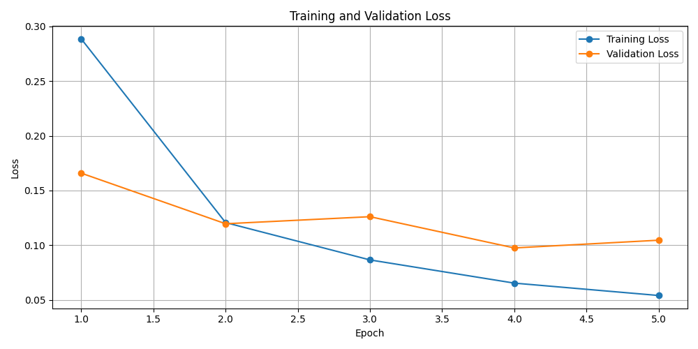
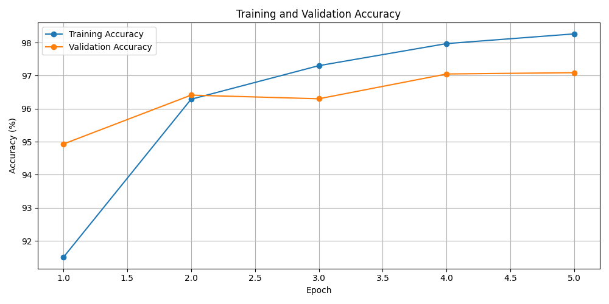

# MNIST Veri Seti ile MLP Tabanlı El Yazısı Rakam Tanıma

Bu proje kapsamında, PyTorch kullanılarak CNN (Evrişimli Sinir Ağı) mimarisi kullanılmadan, temel bir Multi-Layer Perceptron (MLP) modeli oluşturulmuş ve MNIST veri seti üzerinde eğitilmiştir. Model, 0 ile 9 arasındaki el yazısı rakamlarını sınıflandırmak üzere tasarlanmıştır.

## 1. Kullanılan Hiperparametreler ve Model Mimarisi

- **Batch Size:** 64
- **Epoch:** 5
- **Learning Rate:** 0.001
- **Optimizer:** Adam
- **Loss Fonksiyonu:** CrossEntropyLoss
- **Model Mimarisi:** Girdi Katmanı (784 nöron) → Gizli Katman 1 (128 nöron, ReLU) → Gizli Katman 2 (64 nöron, ReLU) → Çıktı Katmanı (10 sınıf)

## 2. Eğitim Sonuçları

Model, MNIST veri seti üzerinde 5 epoch boyunca eğitilmiştir. Son epoch sonunda elde edilen sonuçlar aşağıdaki gibidir:

- **Training Loss:** 0.0541
- **Training Accuracy:** %98.26
- **Validation Loss:** 0.1046
- **Validation Accuracy:** %97.09
- **Test Loss:** 0.0926
- **Test Accuracy:** %97.21
- **Toplam Eğitim Süresi:** 69.88 saniye

Eğitim sürecindeki sonuçlar aşağıdaki tabloda gösterilmiştir:

| Epoch | Train Loss | Train Accuracy | Validation Loss | Validation Accuracy |
|---|---:|---:|---:|---:|
| 1 | 0.2886 | %91.50 | 0.1659 | %94.93 |
| 2 | 0.1207 | %96.29 | 0.1196 | %96.41 |
| 3 | 0.0866 | %97.30 | 0.1261 | %96.30 |
| 4 | 0.0654 | %97.97 | 0.0975 | %97.05 |
| 5 | 0.0541 | %98.26 | 0.1046 | %97.09 |

Model, test veri setinde %97.21 doğruluk oranına ulaşmıştır. Bu sonuç, modelin MNIST veri setindeki rakamları yüksek doğrulukla sınıflandırabildiğini göstermektedir.

## 3. Loss ve Accuracy Grafikleri

Eğitim sürecindeki kayıp (Loss) ve doğruluk (Accuracy) değişimleri aşağıdaki grafiklerle görselleştirilmiştir.

### Loss Grafiği



### Accuracy Grafiği



## 4. Kendi El Yazımla Model Testi ve Değerlendirme

Model, kendi el yazımla hazırladığım öğrenci numaramın (24120205034) rakamları üzerinde de test edilmiştir. MNIST test veri setinde %97.21 doğruluk oranına ulaşmasına rağmen, kendi el yazımla hazırladığım rakamları sınıflandırırken hatalı tahminlerde bulunmuştur. Önceki test sonuçlarında optimize etmeden önce 11 rakamdan 2'sinin doğru tahmin edildiği senaryo da olmuştur. Bu, yaklaşık %18.18 doğruluğa karşılık gelmektedir.

### Genel Değerlendirme: Distribution Shift ve Generalization

Bu durumun temel nedenlerinden biri, eğitim verisi ile gerçek dünyadan alınan görüntüler arasındaki dağılım kaymasıdır (*distribution shift*). MNIST veri setindeki rakamlarla kendi el yazımdaki rakamlar; çizgi kalınlığı, şekil, boyut, konum ve görüntü arka planı bakımından farklılık gösterebilir.

Ayrıca, MLP modelinde 28×28 boyutundaki görüntü 784 elemanlı tek boyutlu bir vektöre dönüştürülür (*flatten*). Bu işlem, görüntünün iki boyutlu uzamsal yapısının doğrudan kullanılmasını sınırlar. Rakamın konumundaki veya şeklindeki küçük farklılıklar bile modelin yanlış sınıflandırma yapmasına neden olabilir.

Sonuç olarak, MNIST veri setindeki yüksek doğruluk oranı, modelin farklı koşullarda elde edilen el yazısı görüntülerinde de aynı başarıyı göstereceği anlamına gelmemektedir. Bu proje, eğitim verisindeki başarı ile gerçek dünyadaki genelleme performansı arasındaki farkı ortaya koymaktadır.

## 5. Proje Dosyaları

- `main.py`: Modelin eğitim ve değerlendirme sürecini çalıştırır.
- `train.py`: Eğitim ve değerlendirme fonksiyonlarını içerir.
- `model.py`: MLP model mimarisini tanımlar.
- `my_digits/`: Test edilen el yazısı rakamı görsellerini içerir.
- `predict_digits.py`: Kendi el yazısı rakamlarını tahmin etmek için kullanılır.
- `results/`: Eğitilmiş model ve sonuç grafiklerini içerir.

## 6. Projeyi Çalıştırma

Gerekli Python kütüphaneleri kurulduktan sonra, modelin eğitim ve değerlendirme sürecini başlatmak için aşağıdaki komut çalıştırılabilir:

```bash
python main.py
```

Kendi el yazısı rakamlarını test etmek için:

```bash
python predict_digits.py
```

## 7. Kullanılan Teknolojiler

- Python
- PyTorch
- Torchvision
- NumPy
- Matplotlib
- Pillow
